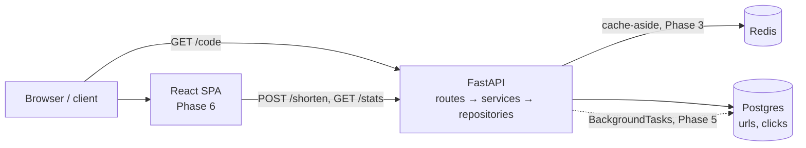

# High-level design: URL shortener

A service that turns long URLs into short codes and redirects those codes back to the original URL.

## Requirements

**Functional**
- Shorten a URL with a random code, or a custom alias (Phase 4).
- Redirect a code to its URL.
- Optional link expiry (Phase 4).
- Click statistics (Phase 5).
- A small web UI (Phase 6).

**Non-functional**
- Redirect is the hot path: fast (p99 under 50 ms server-side) and highly available.
- Links never silently change target: a code collision must never overwrite an existing link.
- Codes are not guessable: generated with `secrets`, from a space of 62⁷ ≈ 3.5 × 10¹² codes.
- Read-heavy: about 100 redirects per link created.

## Load estimate

Target scale for the design, not current traffic.

| | Value |
|---|---|
| New links | 1M / month ≈ 0.4 writes/s average, ~4/s peak |
| Redirects | 100M / month ≈ 40 reads/s average, ~400/s peak |
| Row size | ~500 B (average URL ~100 B, plus code, timestamps and index overhead) |
| Storage | ~0.5 GB / month, ~30 GB over 5 years |

A single Postgres instance handles this comfortably, and Redis (Phase 3) absorbs the read peak.

## Components

Final shape after Phase 7:

## Key data flows

- **Shorten:** validate the URL → generate a code → `INSERT` (unique constraint on `code`) → retry on conflict → return the short URL.
- **Redirect:** Redis `GET code` → on a miss, `SELECT` from Postgres → cache it with a TTL → `302`. The click is recorded in a background task so the redirect isn't slowed down (Phase 5).

## Tradeoffs

| Decision | Choice | Why |
|---|---|---|
| Database | **Postgres** (SQL) | One simple relational table with a unique constraint does exactly what's needed, and clicks aggregate well in SQL. NoSQL buys scale this project won't need. |
| Code generation | **Random base62** | Unguessable and needs no coordination. A counter encoded in base62 never collides, but it's sequential, so links could be enumerated. |
| Collision safety | **Database unique constraint** | The database is the source of truth. Application-level checks alone can race under concurrent requests. |
| Sync vs async database access | **Sync SQLAlchemy + psycopg** | Simpler to learn. FastAPI runs sync routes in a thread pool, which is fine at this load. |
| Redirect status | **302** | Every hit reaches the server, which stats and expiry need. Browsers cache a 301 and may skip the server. |
| Consistency | Strong for writes; the cache may lag by up to its TTL | Links don't change in Phases 2–3, and Phase 4 caps the cache TTL at the link's expiry. |

## Bottlenecks, failures and scaling

- **Hot-path database reads:** served from the Redis cache (Phase 3). If Redis is down, fall back to Postgres (step 3.5).
- **Postgres down:** `/shorten` and cache misses fail with `500`, but the app stays up.
- **Abuse (spam links):** rate limiting and URL validation (Phase 4).
- **Scaling out:** the API is stateless from Phase 2 onwards, so it can run as several replicas behind a load balancer, with a Postgres read replica if needed.

## Tech stack

| Layer | Choice | Why |
|---|---|---|
| Backend | **FastAPI** | Typed, generates API docs automatically, validates input with Pydantic |
| Database | **Postgres 16** | Relational, reliable, unique constraints and good aggregation |
| Cache | **Redis 7** | Fast in-memory key lookups with built-in TTLs |
| Data access | **SQLAlchemy 2 + Alembic** | ORM, plus versioned migrations for schema changes |
| Frontend | **Vite + React + TypeScript** | Fast dev server, typed components |
| Deployment | **Docker Compose**, then Render, Railway or Fly.io | One command runs the API, Postgres and Redis together |
