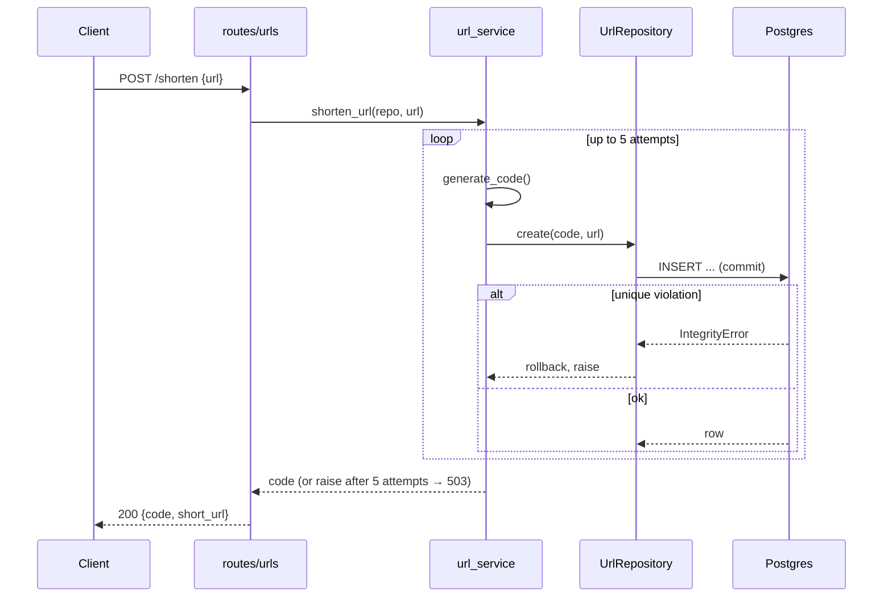
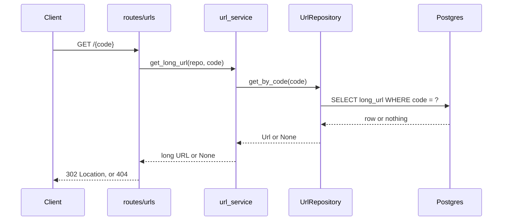

# Low-level design: Phase 2 (Postgres)

Phase 2 replaces the in-memory dictionary with Postgres, so links survive a server restart. See [HLD.md](HLD.md) for the overall design.

## Module layout

New files are marked `+`, changed files `~`.

```
backend/
  .env                      + DATABASE_URL (ignored by Git)
  .env.example              + same keys with fake values (committed)
  requirements.txt          + pinned dependencies (pip freeze)
  alembic.ini, alembic/     + migrations (alembic init)
  app/
    config.py               ~ load DATABASE_URL from .env (python-dotenv)
    db/                     +
      session.py              engine, SessionLocal, get_db() dependency
      tables.py               Base + Url ORM class
    repositories/           +
      url_repository.py       UrlRepository
    services/url_service.py ~ dictionary removed; functions take a repository
    routes/urls.py          ~ gets the repository via Depends; same responses
    models/url.py             unchanged (Pydantic request and response models)
```

ORM classes go in `db/tables.py` rather than `models/`, because `models/` already holds the Pydantic models. That avoids two different kinds of "model" in one folder.

## Responsibilities

| Module | Single job | Depends on |
|---|---|---|
| `config` | Read settings from the environment | — |
| `db/session` | Create the engine; hand out one session per request and always close it | `config` |
| `db/tables` | Map the `urls` table to a Python class | SQLAlchemy |
| `UrlRepository` | All SQL for `urls`: `create(code, long_url)`, `get_by_code(code)` | a `Session` |
| `url_service` | Business rules: code generation and collision retry | a repository, passed in |
| `routes/urls` | Translate between HTTP and the service; map results to 404 and 503 | the service, `Depends` |

**Dependency inversion:** the service receives a repository instead of importing a global. Routes build the repository from the request's session, and tests can pass in a fake one.

## API contracts

Unchanged from Phase 1, plus one new error.

| Endpoint | Success | Errors |
|---|---|---|
| `POST /shorten` with `{"url": ...}` | `200 {"code", "short_url"}` | `422` invalid URL · `503` no free code after 5 tries |
| `GET /{code}` | `302` with a `Location` header | `404 {"detail": "Short URL not found"}` |
| `GET /health` | `200 {"status": "ok"}` | — |

## Database schema

Table `urls`, created by the first Alembic migration:

| Column | Type | Constraints |
|---|---|---|
| `id` | `BIGINT` identity | Primary key |
| `code` | `VARCHAR(16)` | `NOT NULL`, **unique index** (used by the redirect lookup) |
| `long_url` | `TEXT` | `NOT NULL` |
| `created_at` | `TIMESTAMPTZ` | `NOT NULL DEFAULT now()` |
| `expires_at` | `TIMESTAMPTZ` | Nullable (used in Phase 4) |

The unique index on `code` provides both collision safety and fast `WHERE code = ?` lookups, so no other index is needed yet. Postgres compares `VARCHAR` values case-sensitively, so `aB3` and `ab3` are different codes, as base62 requires.

## Design patterns

- **Repository:** keeps all SQL in one class, so routes barely change (step 2.6) and Phase 3 can wrap it with a cache.
- **Dependency injection** (`Depends(get_db)`): one session per request, closed in a `finally` block even when the request fails.
- **Optimistic insert:** try the `INSERT`, catch `IntegrityError`, roll back and retry with a new code. Unlike checking first and then inserting, this can't race with a concurrent request.

## Sequence: shorten



## Sequence: redirect



## Edge cases and validation

- **Collision under concurrency:** the unique constraint plus retry replaces the Phase 1 `while code in urls` loop.
- **Missing `DATABASE_URL`:** fail at startup with a clear error, not on the first request.
- **Database down:** requests that need it fail with `500`; `/health` stays up. A database-aware health check is an option for Phase 7.
- **Very long URLs:** `HttpUrl` caps them at 2083 characters, and `TEXT` stores any length.
- **URL normalisation:** Pydantic adds a trailing `/` to bare hosts, and the normalised form is what gets stored.
- **Session leaks:** `get_db` closes the session in `finally`.

## Checklist mapping

| Step | Work |
|---|---|
| 2.1 | Run Postgres in Docker |
| 2.2 | Install dependencies; add `DATABASE_URL` to `.env` |
| 2.3 | Define the `Url` table class |
| 2.4 | Set up Alembic and run the first migration |
| 2.5 | Write `UrlRepository` |
| 2.6 | Make the service and routes use the repository; retry on `IntegrityError` |
| 2.7 | Restart and confirm old links still redirect; commit |

## Done when

- `alembic upgrade head` creates the `urls` table.
- Shorten a link, restart the server, and the old link still returns `302`.
- An unknown code returns `404`, an invalid URL returns `422`, and `/health` returns `200`.
- `psql` shows the row, and a unique index on `code`.
- A forced duplicate code is retried rather than overwriting the existing link.
